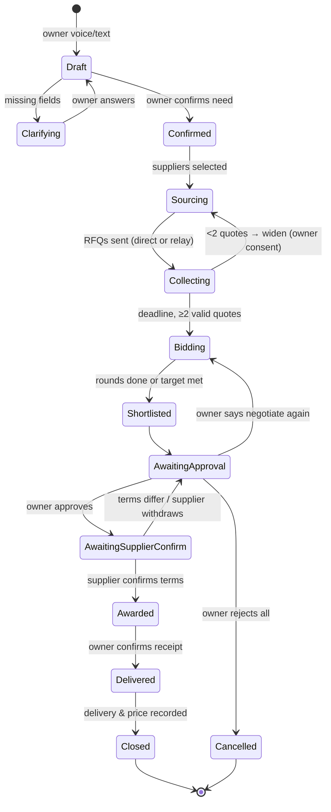
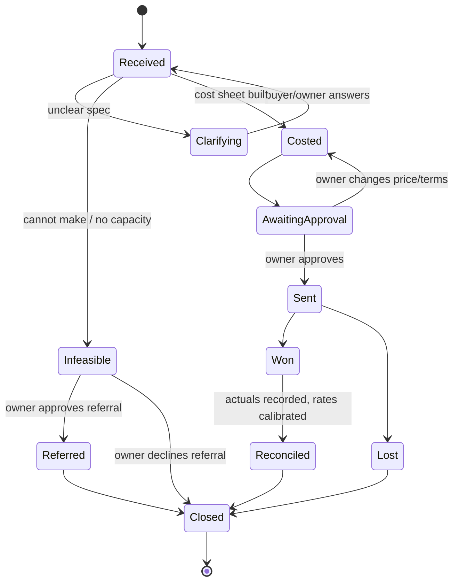

# Handel — Product Specification

| | |
|---|---|
| **Project** | Handel |
| **Problem statement** | Tech4Bharat 2026 · 4.1 · Agentic AI |
| **Version** | 0.3 |
| **Date** | 2026-11-20 |
| **Implements** | [`01-requirements.md`](01-requirements.md) v0.1.3 |
| **Evidence** | [`00-desk-research.md`](00-desk-research.md) (field visits not possible; see requirements §12) |
| **Related** | [`00-field-research-plan.md`](00-field-research-plan.md) (optional validation) · `03-architecture.md` (next) |

### Change log

| Version | Changes |
|---|---|
| 0.1 | First specification |
| 0.2 | After review: messaging layer independent of any one app, with Telegram for the prototype and an owner-relay mode; transporter freight quotes; relationship mode; cost-rate builder; capacity referral (M-15); two-sided award confirmation; a signal when every quote is above the market; DPDP compliance; WhatsApp limits recorded; positioning against existing options; quality metrics fixed; R1 scope reduced; assumptions A-12 to A-16; traceability corrected |
| 0.3 | Phone calls added as a channel (Vobiz): Handel calls suppliers, owners call Handel, Handel calls owners at decision points (§5.6, MSG-17 to MSG-19, AI-10, AT-17 to AT-19). Model and provider choices (Claude API, Sarvam) recorded in `03-architecture.md` v0.2 |
| 0.2.1 | No field visits: datasets switched to team-made and public test data (T-1 to T-6); metrics that needed field data are marked as pilot-only; default cost-of-money values taken from desk research; R1 covers the 57 Must requirements that can be met |

---

## 1. Purpose

This document says **how Handel behaves**: its modules, workflows, rules, data, messages and quality targets. That is enough detail to design the architecture and write tests against.

It does not choose technology. Models, frameworks, hosting and database products belong in `03-architecture.md`.

Every module traces back to requirement IDs. Anything that depends on field research is marked **[A-n]** and listed in [section 17](#17-assumptions).

## 2. Product definition

> **Handel is an AI purchasing and costing agent for small factories.**
> - The owner speaks a need into a chat app.
> - Handel gets suppliers and transporters competing for the order and turns their messy quotes into one true landed cost.
> - It negotiates within the owner's limits, and the owner approves the award with one tap.
> - When a buyer sends an enquiry, Handel builds the cost sheet from rates it helped the owner work out, and warns before the owner quotes at a loss.
> - When the unit can't take a job, Handel can pass it to a nearby unit that can, so the cluster wins more work together.

**The three parts of problem 4.1, and how Handel answers each:**

| Part of 4.1 | Handel's answer | Modules |
|---|---|---|
| Overpaying for material | Competitive requests for quotes and bidding, landed cost, benchmarks, deals, pooling | M-02 to M-10 |
| Quoting at a loss | Rate builder, feasibility check, cost sheet, loss warning, quoted against actual | M-01, M-11 |
| Dependence on a few local buyers | Fast costed quotes (more bids answered), capacity referral between units, enquiry-source tracking | M-11, M-15, M-14 |

**Handel is:**
- an agent that acts for one owner
- a competitive bidding engine run by that agent
- a network of units that grows as more units join

**Handel is not:**
- a marketplace that owners and suppliers must log in to and operate themselves
- a payment system
- a web scraper

## 3. Design decisions

| ID | Decision | Instead of | Why | Traces to |
|---|---|---|---|---|
| D-01 | Handel is an **agent acting for the owner**. Marketplace-like features are tools the agent runs. | A self-serve two-sided marketplace | The agentic bar requires a system that acts for its user. A marketplace starts empty on both sides. | HC-07, AG-01 to AG-07 |
| D-02 | A **messaging layer independent of any one app**. **Telegram** is the prototype channel. A **WhatsApp** adapter is used where field research shows people need it. An **owner-relay mode** covers suppliers who join neither. | Building only for WhatsApp | Telegram's bot API is free and needs no message-template approval. It supports voice, photos, buttons and in-app web pages. WhatsApp is what most traders already use, but business-initiated messages need approved templates and are charged per message. Relay mode means no supplier is ever required to adopt anything. | FR-BUY-02, NF-05, NF-10, OQ-09 |
| D-03 | Downward bidding is a **reverse auction run by the agent**: a sealed first round, then up to 2 improvement rounds with truthful rank feedback. | An open public reverse auction | Suppliers compete without exposing each other's prices or identities. The owner keeps the award decision. | FR-BUY-08, BD-01, BD-02 |
| D-04 | **Relationship mode** for each supplier. Relationship suppliers are compared quietly and never pushed through bidding rounds. | Every supplier in every auction | Local traders often give regular customers credit. Aggressive bidding could cost the owner that credit, or the supplier. | FR-BUY-14, A-13 |
| D-05 | **Supplier deals** are matched to owners with a need. An owner may accept, or make **one sealed offer** within their ceiling, alone or pooled. | Open upward bidding among buyers | Open upward bidding pushes up the price Handel's own users pay. | FR-BUY-11, FR-POOL-01, FR-POOL-02 |
| D-06 | **Market Scout** uses **permitted sources only**. | Scraping websites | Respects HC-05. Local trader rates are mostly not online anyway. | FR-BUY-09, FR-BUY-12, HC-05 |
| D-07 | A **rate builder** derives cost rates from the power bill, wages, rent, machine list and past jobs. | Asking owners for machine-hour rates | Owners quote by rule of thumb because they don't know these rates. | FR-QUO-08, A-14 |
| D-08 | **Capacity referral** between Handel units, rather than buyer discovery on public platforms first. | Scraping tenders or marketplaces | It uses the network Handel already has, is agentic and needs consent. Associations and clusters are named in 4.1. | FR-MKT-01, FR-MKT-03, A-15 |
| D-09 | First segment: **steel fabrication** (MS sheet, plate, pipe, sections). **[A-1]** | All segments at once | Standard specifications, units that convert by weight, and reference prices make accuracy testable. | OQ-05 |
| D-10 | Languages: **R1 = one Indian language + English** (including mixed speech), chosen by the field location. **R2 adds a second Indian language.** **[A-2]** | Four languages at once | Depth over breadth. Quality can be measured on a dataset we can actually label. | NF-02, NF-03 |

### 3.1 Positioning against existing options (EV-T4)

| Option today | What the owner still does | What Handel adds |
|---|---|---|
| Phone and chat with known suppliers | All the calling, comparing and remembering, by hand | An agent that does the calling, comparing and chasing, in the same chat apps |
| B2B marketplaces and procurement platforms | Logs in, posts, reads bids and compares terms themselves. Usually no help with landed cost or with quoting to buyers. | Acts for the owner. Converts every quote to effective landed cost. Links buying to costing. Works by voice, in their language. |
| Accounting and billing software | Records transactions after the fact | Acts before the purchase and before the quote |

Our claim is limited to these differences. We don't claim that no other tool has any one of these features.

## 4. Actors and permissions

| Actor | Interface | Can | Cannot |
|---|---|---|---|
| **Owner** (ST-01) | Chat (voice, text, photo, buttons); read-only case page | Raise needs and enquiries; set limits and supplier modes; approve or reject awards, quotes and referrals | — |
| **Owner's delegate** **[A-3]** | Chat | Raise needs; answer clarifying questions | Approve awards, quotes or referrals unless the owner grants it explicitly |
| **Supplier** (ST-02) | Chat; optional bid page; or through the owner (relay) | Reply to requests for quotes; lower bids; post deals; decline; opt out; ask for their data | See other suppliers' identities or prices |
| **Transporter** (ST-04) | Chat or relay | Reply to freight requests | See material prices |
| **Buyer** (ST-03) | Through the owner (forwarded enquiry); receives quotes the owner approved | Send enquiries; receive quotes | Interact with Handel without the owner's involvement |
| **Neighbour unit** (ST-06) | Their own Handel | Join pools; send and receive referrals | See another unit's data without consent |
| **JanAI Café operator** (ST-07) | Operator mode in chat + a simple web console | Onboard units, suppliers and transporters; record consent; enter rate-builder inputs; upload documents | Approve anything for an owner |
| **Handel agent** | All of the above | Every action not reserved for a person | Award, pay, send a quote, refer a job, share personal data, or exceed a limit |

## 5. Interaction model

### 5.1 Messaging layer
- All modules talk to a **channel-neutral messaging layer**: send text, voice, image or document; ask with buttons; receive any of these.
- Adapters translate this to each app.
- A person's identity is linked across channels by verified phone number.

| Channel | Role | Limits Handel must respect |
|---|---|---|
| **Telegram bot** | Prototype and pilot default | A bot **cannot message someone first**. The person must start the bot, which is solved by an invite link (§5.3). Voice, photos, documents, buttons and in-app web pages (Mini Apps) are supported. |
| **WhatsApp Business** | Pilot channel where field research says suppliers won't use Telegram **[A-12]** | Business-initiated messages need **pre-approved templates**. Free-form messages are allowed only **within 24 hours** of the person's last message. The test number can message only a **small number of verified recipients**. Messages are **charged**. *(Check Meta's current terms before building; record them in `03-architecture.md`.)* |
| **Phone call** | Voice channel for all three parties: Handel calls suppliers, owners call Handel, Handel calls owners at decision points (§5.6) | Indian calling rules: no cold calls; consent recorded before business talk; calls only during business hours; caller ID must be Handel's own Indian number. A call costs money per minute. |
| **Owner relay** | Fallback for any supplier, transporter or buyer who joins neither | Handel drafts the message, the owner forwards it from their own phone, and forwards the reply back. Handel parses the forwarded reply exactly like a direct one. |

### 5.2 Owner
- **Input:** voice notes (primary), text, photos (drawings, slips, samples), forwarded messages.
- **Output:**
  - short replies in the owner's language
  - a **voice summary** at every decision point
  - **buttons** for decisions (at most 4)
  - a link to a read-only case page
- **Commands are natural speech, not keywords.** Handel must understand intents like these:

| Intent | Example (English gloss) |
|---|---|
| New purchase | "Need 2 ton MS sheet, 2 mm, 8 by 4, by Friday" |
| Set limit | "Don't go above 64 per kilo" |
| Supplier mode | "Don't make Ravi Steels bid, he gives me credit" |
| Status | "What happened with the sheet order?" |
| Approve or reject | "Give it to Murugan Steels" / button |
| New enquiry | (forwards buyer's drawing) "Make a quote for this, 500 pieces" |
| Refer | "I can't do this one, pass it on" |
| Add supplier or transporter | "Add Lakshmi Traders, 98xxxxxxx" |
| Pause or cancel | "Stop the sheet order" |

### 5.3 Supplier and transporter onboarding (one step)
1. The owner adds a contact. Handel creates a personal **invite message** with a deep link to the bot.
2. The **owner forwards it** from their own phone, so the first contact comes from someone the supplier knows. This is a message between people, not an automated one.
3. The supplier taps the link and sees the **notice and consent** (MSG-01), in their language. They join with one tap.
4. A supplier who doesn't join is handled in **relay mode** automatically. Nothing blocks the case.

### 5.4 Bid page
- An optional page that opens inside the chat app (a Telegram Mini App) or in the browser. No login, a token that expires, under 200 KB.
- Shows the request, the supplier's own offer, their **rank band** and a field to submit a lower price.
- Replying in chat is always just as valid.

### 5.5 Operator (JanAI Café)
- **Operator mode** in the bot, plus a simple web console.
- Used for: onboarding units, suppliers and transporters; recording consent; entering rate-builder inputs from bills; uploading documents.
- Everything an operator enters is marked as operator-entered.

### 5.6 Phone calls
Phone calls are a channel like any other: every call belongs to a case, and its outcome (a quote, a need, an approval) is recorded exactly as a chat message would be. Three flows:

| Flow | Who starts | What happens | Ends with |
|---|---|---|---|
| **Supplier RFQ call** | Handel | Handel calls a supplier the owner added. It says who it is and who it acts for, asks consent (MSG-17), reads the request for quotes, collects rate, freight, GST, payment terms, delivery and validity, then **reads the terms back** for the supplier to confirm (MSG-18). | A structured quote (`via = call`) with the call recording and transcript as its source |
| **Owner calls Handel** | Owner | The owner dials Handel's number and speaks naturally: a new need, a status question, a limit, an approval. Same intents as §5.2. | A case event (new need, answer, approval request) |
| **Decision call** | Handel | At a decision point (shortlist MSG-09, loss warning MSG-10, expiring quotes) Handel rings the owner, speaks the summary and asks for a decision (MSG-19). | A recorded approval, or "send me the details on Telegram" |

**Rules for calls:**
- **Disclosure first.** The first sentence of every outgoing call says it is an AI assistant acting for the named unit. A supplier who declines is never called again for that unit and falls back to relay.
- **Consent before business.** A supplier's consent is asked and recorded at the start of the first call (MSG-17), with the notice version and the call reference. Calls are recorded only after announcing it; if the person says no, the call continues unrecorded.
- **Who and when.** Handel calls only numbers the owner added to their book, only about an open case, only within business hours, and at most a set number of attempts per case (default 2).
- **What Handel may say.** Every figure spoken on a call (quantities, dates, prices, rank) comes from the rules engine and passes the same checks as written messages (RULE-B2 to RULE-B4). Handel never speaks the owner's ceiling, another supplier's name or another supplier's price.
- **Approvals by phone** need the owner's 4-digit PIN on the keypad (set at onboarding), because a caller's number can be faked. Without the PIN, Handel sends the decision to Telegram instead.
- **Read-back.** Every quote taken on a call is read back and confirmed before it counts. Unclear fields get one question each, as in MSG-04.
- **Failures.** No answer or a busy line counts as an attempt and follows the M-12 recovery table (reminder, then relay). A dropped call keeps whatever was confirmed and asks the rest in a follow-up message or call.

## 6. Modules

| ID | Module | Main requirements | Release |
|---|---|---|---|
| M-01 | Onboarding, profiles and **rate builder** | FR-QUO-02, FR-QUO-08, NF-07, DT-01, DT-05 | R1 |
| M-02 | Intake: understanding needs | FR-BUY-01, FR-BUY-03, FR-QUO-01, NF-01 to NF-04 | R1 |
| M-03 | Sourcing, requests for quotes and **freight requests** | FR-BUY-01, FR-BUY-02, FR-BUY-06, FR-BUY-13 | R1 (freight: R2) |
| M-04 | Quote reader | FR-BUY-03 | R1 |
| M-05 | Landed-cost engine | FR-BUY-04, FR-BUY-07 | R1 |
| M-06 | Competitive bidding and relationship mode | FR-BUY-08, FR-BUY-14, BD-01 | R1 |
| M-07 | Recommendation and award | FR-BUY-05, BD-02 | R1 |
| M-08 | Market Scout | FR-BUY-09, FR-BUY-12 | R2 |
| M-09 | Supplier deals | FR-BUY-11 | R2 |
| M-10 | Pool | FR-POOL-01, FR-POOL-02 | R2 |
| M-11 | Enquiry and costing | FR-QUO-01 to FR-QUO-07, FR-MKT-01 | R1 |
| M-12 | Case manager (plan, memory, recovery) | AG-01 to AG-05, FR-BUY-06 | R1 |
| M-13 | Approvals, consent, privacy and audit | AG-06, BD-01 to BD-04, DT-01 to DT-05 | R1 |
| M-14 | Reports and metrics | FR-BUY-10, FR-QUO-07, FR-MKT-02, EV-T2 | R1 |
| M-15 | Capacity referral | FR-MKT-01, FR-MKT-03 | R1 (basic) |
| M-16 | Messaging layer and adapters | FR-BUY-02, NF-05, NF-06, NF-10 | R1 (Telegram + relay); R2 (WhatsApp if needed) |

### M-01 Onboarding, profiles and rate builder

**Unit profile**
- name, location, GSTIN (optional), languages
- whether the unit claims input tax credit (ITC)
- cost of money `r` **[A-4]**: asked as "what does borrowing cost you?" and taken from their overdraft, loan or moneylender rate. If the owner doesn't know, Handel asks "bank loan or private lender?" and uses a default of **1% or 2.5% per month**, labelled *assumed* (desk research §6).
- business hours, minimum and target margins

**Capability profile**
- machines: type, limits, connected load in kW
- processes and their usual scrap %

**Rate builder** (FR-QUO-08)
- Asks only for what the owner can find: power bill amount and units, operator wages, rent and other fixed monthly costs, shifts and working days, a rough utilisation, and optionally the value of each machine.
- Derives the rates with RULE-R1 to RULE-R6. Each rate is labelled **estimated** and shows its working.
- After jobs are completed, the rates are calibrated against actual results (RULE-R6).

**Supplier and transporter book**
- name, phone, materials or routes, area
- **mode** (compete / relationship)
- source, consent status, channel

**Onboarding paths**
- guided by voice in chat, about 10 minutes, can be resumed
- through a café operator

Missing values are asked for when first needed and are never silently assumed.

### M-02 Intake: understanding needs
- Converts voice, text and photos into a **structured need**: material, grade, form, dimensions, thickness, quantity and unit, needed-by date, delivery location, ceiling (if stated) and notes.
- **Unit conversion:** sheets and plates use `kg = length(m) × width(m) × thickness(mm) × 7.85`. Pipes and sections use a standard weight table **[A-5]**.
- **Clarification:** one combined question, with the most likely answer offered for the owner to confirm.
- **Read-back:** the structured need is read back by voice for confirmation before any supplier is contacted.

### M-03 Sourcing, requests for quotes and freight requests
- **Suppliers invited:**
  - those in the book who deal in this material, both compete and relationship modes
  - plus up to 3 Market Scout suggestions (R2), only with the owner's agreement
  - minimum 3, default maximum 8 **[A-6]**
- **The request for quotes** contains:
  - the specification and quantity
  - delivery location and date
  - the response deadline
  - for compete-mode suppliers only, the bidding rules (RULE-B1 to RULE-B6, in short form)
  - the bid link

  It **never** reveals the ceiling.
- **Freight requests (R2):** for every ex-yard quote in the top 3, Handel sends a freight request to up to 3 transporters for that route and load. The quoted freight replaces the estimate in landed cost.
- **Dispatch:** in each recipient's language, during business hours, through their channel or by relay.

### M-04 Quote reader
- **Input:** a text, voice note, image or PDF, sent directly or forwarded, linked to an open request.
- **Output:** a **structured quote** with:
  - base rate and rate unit
  - quantity
  - GST % and whether a tax invoice will be issued
  - freight terms
  - loading and other charges
  - payment terms
  - delivery date and validity
  - specification deviations
  - a **confidence score and source span for every field**
- **Rules:**
  - A field below the confidence threshold **[A-7]** is confirmed with the sender in one short question.
  - A value that isn't in the message stays **missing**. It is never inferred, except for standing terms taken from the supplier's own history, which are labelled "from history".
  - A quote that doesn't match the specification is flagged and kept, not dropped.

### M-05 Landed-cost engine
Applies RULE-L1 to RULE-L6 to every quote and shows each component. Every component is labelled *quoted*, *estimated*, *assumed*, *from history*, *stale* or *late*, as applicable.

### M-06 Competitive bidding and relationship mode
- **Round 0 (sealed):** all suppliers.
- **Improvement rounds (0–2; owner sets, default 1):** **compete-mode suppliers only**. Each supplier who isn't ranked first gets truthful rank feedback, and the effective landed "price to beat" if the owner allows it.
- **Relationship-mode suppliers:** the request says honestly that "{Unit} is comparing quotes". They get no rank feedback and no rounds. The owner may ask a relationship supplier to "match" a better offer, but only with the owner's explicit approval for that supplier.
- Bidding stops early when the owner's target is met.
- Output: a ranked shortlist only. Rules: RULE-B1 to RULE-B6.

### M-07 Recommendation and award
- Presents the **top 3** by voice and text. For each: effective landed cost, what makes up the difference, delivery date, the supplier's reliability note, and (from R2) the benchmark.
- One recommendation, with a one-sentence reason.
- The owner chooses `Approve` / `Choose other` / `Negotiate again` / `Reject all`.
- **Award with confirmation from both sides:**
  1. The award message restates the **exact agreed terms**.
  2. The supplier must reply to confirm them.
  3. If the supplier confirms different terms, the case goes back to the owner.
  This guards against misread quotes causing a wrong order.
- **Handel never pays.** Payment happens between people, outside Handel.
- If the supplier withdraws after the award, Handel offers the next ranked supplier, and the owner approves again.

### M-08 Market Scout (R2)
- **Supplier discovery.** Sources, in order:
  1. the owner's past suppliers
  2. suppliers in other units' books who consented to referrals
  3. operator-entered local suppliers
  4. official directory APIs or licensed datasets **[A-8]**

  New suppliers are marked **"new, unverified"**.
- **Benchmarks.** A dated reference price from a licensed or public index **[A-8]**, or the anonymised median of recent effective landed costs across units (only when there are at least 3 data points). The source and date are always shown.
- **"All quotes above market" signal.** If every valid quote is more than **x%** **[A-7]** above the benchmark, Handel tells the owner. The cause could be a market move or suppliers coordinating prices, so Handel suggests widening the supplier set. It never accuses anyone.
- **Prohibited:** scraping sites whose terms forbid it. Anything not from a live permitted source is labelled **MOCK**.

### M-09 Supplier deals (R2)
- **Flow:**
  1. The supplier posts a deal in free form, and M-04 reads it into a structured deal.
  2. The deal goes only to owners with a matching open need, or who opted in to deal alerts. Owners' identities are hidden until they respond.
  3. Each owner can accept at the asked price, make **one sealed offer** (never above the ceiling), propose a pool, or ignore it.
  4. The supplier chooses, and Handel informs everyone involved.
- No open upward bidding.

### M-10 Pool (R2)
- **Triggered by:** two or more units with matching open needs in the same area within an overlapping time window, or a deal larger than one unit's need.
- Each owner sees the combined quantity, their own share and the split (RULE-P1 to RULE-P3), and approves only their share.
- One request for quotes.
- **Each unit is invoiced separately** **[A-16]** and pays its own share.
- MVP: 2–3 units, one route.

### M-11 Enquiry and costing
1. **Intake:**
   - the buyer's enquiry is forwarded or spoken, and the enquiry source is recorded
   - Handel extracts the part, material, thickness, dimensions, operations, quantity, finish and delivery
   - it drafts questions for the buyer
2. **Feasibility** against the capability profile: **can make / cannot make / need clarification**, with reasons. "Cannot make" or "no capacity" offers a **referral** (M-15).
3. **Cost sheet:** RULE-C1 to RULE-C7, using the latest valid landed rate (M-05) and the rates from the rate builder. If no material rate is valid, Handel offers to run a quick request for quotes first.
4. **Pricing:** floor and target. A price below cost triggers a **loss warning**, and a price below the floor triggers a **thin-margin warning**.
5. **Approval:** the owner approves (BD-03). Handel then produces the quote message or PDF in the owner's name. Its validity is at most the material rate's validity.
6. **Speed:** the target from receiving an enquiry to a draft cost sheet is under 5 minutes, once the spec is clear. This is how the unit answers more bids (FR-MKT-01).
7. **Follow-up:**
   - records won, lost or price feedback
   - after the job, asks for actual material and hours
   - reports quoted against actual
   - calibrates the rates (RULE-R6)

### M-12 Case manager (plan, memory, recovery)
Every purchase, deal, pool, enquiry and referral is a **case**. Each case has:
- a state (see [section 7](#7-workflows-and-states))
- an explicit, visible **plan**: next steps with due times
- a **timeline** of every message, decision and tool action
- **memory across cases**: supplier responsiveness, price history, deviations, delivery record and owner preferences

**Recovery behaviours (AG-05):**

| Situation | Handel's response |
|---|---|
| No reply by `T1` **[A-9]** | Reminder |
| No reply by `T2` | Mark as no response. Switch that supplier to relay (ask the owner to forward). Add another supplier if fewer than 3 quotes are expected. |
| Recipient never joined the bot | Relay mode automatically |
| Quote can't be read or confidence is low | Ask one question, or ask for a voice note |
| Message fails to send or the connection drops | Queue and retry with backoff. The case state is kept on the server, so nothing is lost. |
| Messaging-window or template limits (WhatsApp) | Use an approved template, or fall back to relay |
| Owner silent before quotes expire | Remind the owner. Ask suppliers to extend validity. |
| Price changes after the shortlist | Re-rank and explain what changed |
| Supplier confirms different terms at award | Back to the owner with the difference |
| Supplier withdraws after the award | Next ranked supplier, with a new owner approval |
| Fewer than 2 valid quotes at the deadline | Extend once, or widen (R2), with consent |
| Enquiry not feasible | Explain why. Offer to refer it. |

### M-13 Approvals, consent, privacy and audit
- **Approval gate.** Handel cannot do any of these without a recorded approval from an authorised person:
  - award
  - send a quote
  - join a pool
  - refer a job
  - share personal data
  - exceed a limit
  - make any statement that commits the owner
- **DPDP compliance** (DT-05):
  - a plain-language **notice** in the person's language, saying what is collected, why, and who to contact
  - **consent** recorded per person and purpose, and **withdrawable** ("STOP" or "delete my data")
  - **access, correction and erasure** on request
  - a named **grievance contact**
  - personal data used **only for the stated purpose**
  - minimised to [section 9](#9-data-model)
- **Audit log:** append-only, records agent actions and approvals, and the owner can export it.
- No payment credentials are ever stored.

### M-14 Reports and metrics
**For the owner, every week by voice:**
- savings against the first quote and against the benchmark
- quotes sent, won and lost
- jobs that lost money
- enquiries by source
- referrals sent and received

**For evaluation:** see [section 14](#14-quality-and-evaluation-plan).

### M-15 Capacity referral
- **Triggered** when the owner declines an enquiry, or M-11 finds it infeasible or over capacity.
- Handel offers to refer it. If the owner agrees, it finds nearby Handel units whose capability profile matches (e.g. "laser 6 mm MS, press brake 2.5 m").
- **What is shared:**
  - at first, only the **job specification** (no buyer identity), and only what the referring owner approves
  - the buyer's identity, only after the receiving owner accepts **and** the buyer has consented (BD-04)
- Any **referral fee or favour** is agreed between the owners. Handel records the agreement but handles no money.
- The receiving unit handles the enquiry through M-11 as normal.
- Referrals given and received are reported (M-14).
- Rules: RULE-F1 to RULE-F4.

### M-16 Messaging layer and adapters
See [section 5.1](#51-messaging-layer). Requirements:
- every message has a unique ID and is **idempotent** (sending it twice has no extra effect)
- an outbound queue with retries
- inbound messages are de-duplicated
- each identity's channel and consent are tracked
- relay drafts are tagged so forwarded replies can be matched back to their case
- phone calls: each call is tied to a case and a party; consent, recording status, transcript and outcome are stored with it; outgoing calls respect business hours and the per-case attempt limit (§5.6)

## 7. Workflows and states

### 7.1 Purchase case

### 7.2 Enquiry case

### 7.3 Deal, pool and referral flows
- **Deal:** `Posted → Parsed → Matched → Offered → Responses → Supplier chooses → Owner(s) approve → Awarded → Closed` (or `Expired`).
- **Pool:** `Proposed → Each owner approves share → Combined request for quotes (purchase flow) → Each owner approves award for their share → Separate invoices and deliveries → Closed`. If a member withdraws, Handel recalculates the split and asks the others to approve again.
- **Referral:** `Offered (specification only) → Receiver accepts → Buyer consents → Details shared → Receiver handles it in M-11 → Outcome recorded`.

## 8. Business rules

### 8.1 Landed cost (per kg or per unit)

| Rule | Definition |
|---|---|
| RULE-L1 | `base` = quoted rate converted to ₹/kg (M-02 conversions). |
| RULE-L2 | `freight`: delivered = 0. Ex-yard = the best **quoted** freight from M-03 ÷ quantity, or, until one exists, the transporter-book rate labelled *estimate*. |
| RULE-L3 | `charges` = loading + unloading + cutting + other stated charges, per kg. |
| RULE-L4 | `tax` = 0 if the unit claims input tax credit **and** a tax invoice will be issued. Otherwise GST as stated (or the standard rate, labelled *assumed*). Quotes without a tax invoice are shown as **not eligible for input tax credit**. |
| RULE-L5 | `money` = `(base + freight + charges) × r × (d_pay / 30)`. `r` = the owner's cost of money per month. `d_pay` = days paid before delivery (advance is positive; credit is negative, equal to minus the credit days). |
| RULE-L6 | `effective_landed = base + freight + charges + tax + money`. Late quotes are flagged *late* and ranked below on-time quotes unless the owner says otherwise. Expired quotes are flagged *stale* and must be refreshed before an award. |

### 8.2 Ranking
1. Exclude quotes with an unresolved specification deviation (they're shown separately).
2. Sort by `effective_landed`, ascending.
3. Tie-break (within 0.5%): on-time delivery, then supplier reliability, then longer credit.

### 8.3 Competitive bidding

| Rule | Definition |
|---|---|
| RULE-B1 | Bidding rules are stated in the request for quotes before any bid. |
| RULE-B2 | **Truthfulness:** Handel never claims a lower offer exists unless it does. All feedback is true when sent. |
| RULE-B3 | **Confidentiality:** a supplier's identity and prices are never revealed to another supplier. "Price to beat" is shown as an effective landed figure, never as another supplier's quote. |
| RULE-B4 | **Owner's limits:** the ceiling is never disclosed. Handel never proposes or accepts terms outside the owner's limits. |
| RULE-B5 | **Round limits:** at most 2 improvement rounds, each at least 2 business hours long **[A-9]**. A bid may only improve. Relationship-mode suppliers are excluded from rounds. |
| RULE-B6 | **No auto-award:** the outcome is a recommendation only. |

### 8.4 Rate builder

| Rule | Definition |
|---|---|
| RULE-R1 | `productive_hours/month` = shifts × hours per shift × working days × utilisation (the owner's estimate, default asked, never assumed). |
| RULE-R2 | `tariff` (₹/kWh) = bill amount ÷ units on the bill. `power_cost/hr` for a machine = connected kW × load factor **[A-14]** × `tariff`. |
| RULE-R3 | `labour/hr` = monthly operator wages ÷ productive hours. |
| RULE-R4 | `overhead/hr` = (rent + non-operator salaries + other fixed costs) ÷ total productive machine hours. |
| RULE-R5 | `depreciation/hr` (optional) = (machine value ÷ life in years) ÷ annual productive hours. Labelled *optional estimate*. |
| RULE-R6 | **Calibration:** after each reconciled job, compare estimated with actual hours and cost, and propose adjusted rates for the owner to accept. Show the error trend. |

### 8.5 Costing (per piece, for an enquiry)

| Rule | Definition |
|---|---|
| RULE-C1 | `material_kg` = net part weight × (1 + scrap %), or blank or nesting weight where known. |
| RULE-C2 | `material_cost` = `material_kg` × latest valid `effective_landed` rate. |
| RULE-C3 | `process_cost` = Σ machine hours per piece × (power + labour + depreciation)/hr. Setup time is spread across the batch quantity. |
| RULE-C4 | `consumables_packing` = as set per process, or 0 with a prompt to fill it. |
| RULE-C5 | `overhead` = machine hours per piece × `overhead/hr` (RULE-R4). |
| RULE-C6 | `freight_out` = delivery cost to the buyer ÷ quantity. |
| RULE-C7 | `cost` = C2 + C3 + C4 + C5 + C6. `floor` = cost × (1 + minimum margin). `target` = cost × (1 + target margin). A price below `cost` raises a **loss warning**. A price below `floor` raises a **thin-margin warning**. Quote validity ≤ the material rate's validity. Every derived rate used is labelled with its source. |

### 8.6 Pooling

| Rule | Definition |
|---|---|
| RULE-P1 | Material cost is split by quantity share. |
| RULE-P2 | Shared freight is split by weight share. Separate drop-offs add each unit's own last-leg cost. |
| RULE-P3 | Every member sees the full split before approving. Each member approves, is invoiced for and pays only their own share. |

### 8.7 Referral

| Rule | Definition |
|---|---|
| RULE-F1 | Only the job specification is shared at first. The buyer's identity is shared only after the receiving owner accepts **and** the buyer consents. |
| RULE-F2 | A job is referred only to units whose capability profile matches every required operation. |
| RULE-F3 | The referring owner approves each referral. The receiving owner approves each acceptance. |
| RULE-F4 | Referral terms between owners are recorded as text only. Handel moves no money. |

## 9. Data model

Entities and key fields. Storage design belongs in the architecture document.

| Entity | Key fields |
|---|---|
| **Unit** | id, name, location, languages, gstin?, itc_eligible, cost_of_money_r, business_hours, min_margin, target_margin |
| **RateCard** | unit_id, inputs{power_bill, units_kwh, wages, rent, fixed_costs, shifts, days, utilisation, machine_values?}, derived{tariff, labour_hr, overhead_hr, power_hr per machine, depreciation_hr?}, calibration_history[] |
| **Person** | id, unit_id?, role (owner / delegate / operator), name, phone, language, permissions |
| **ChannelIdentity** | person_or_party_id, channel (telegram / whatsapp / relay), handle, verified_at |
| **Capability** | unit_id, machine_type, limits, connected_kw, scrap_pct |
| **Supplier** | id, name, phone, materials[], area, mode (compete / relationship), source, verified, consent_status, language |
| **Transporter** | id, name, phone, routes[], rate_basis, book_rate, consent_status |
| **Material** | id, category, grade, form, std_dims, weight_rule |
| **Need** | id, unit_id, material_id, spec, qty, unit, needed_by, location, ceiling?, target?, status |
| **PurchaseCase** | id, need_id, state, plan[], invited[], rounds, deadline, pool_id? |
| **Quote** | id, case_id, supplier_id, round, raw_ref, via (direct / relay), fields{value, confidence, source_span}, deviations[], valid_until |
| **FreightQuote** | id, case_id, transporter_id, route, load, amount, valid_until |
| **LandedCost** | quote_id, base, freight, charges, tax, money, effective, labels[] |
| **Deal** | id, supplier_id, material_id, qty, price_basis, expires_at, status, offers[] |
| **Pool** | id, members[{unit_id, qty, share, approved}], case_id, split_table |
| **Enquiry** | id, unit_id, source, buyer_ref, raw_refs[], structured_spec, feasibility, status |
| **CostSheet** | enquiry_id, lines[], cost, floor, target, rate_refs[], valid_until |
| **Referral** | id, enquiry_id, from_unit, to_unit, shared_fields[], buyer_consent, terms_text, status |
| **Approval** | id, case_ref, action, approver_id, timestamp, channel |
| **Consent** | party_id, party_type, purpose, notice_version, language, granted_at, withdrawn_at? |
| **DataRequest** | id, party_id, type (access / correct / erase), status, resolved_at |
| **AuditEvent** | id, case_ref, actor (person / agent), action, payload_ref, timestamp |
| **PricePoint** | material_id, region, price, basis, source, date, is_mock |

## 10. Message catalogue

Templates are written in English below and delivered in the recipient's language. Every message to a third party says who Handel acts for.

| ID | To | Purpose | Template (English) |
|---|---|---|---|
| MSG-00 | Supplier or transporter, **forwarded by the owner** | Invite | "Hi, it's {Owner}. I'm using Handel, an assistant that collects rates for my unit. Tap to receive my enquiries: {invite_link}" |
| MSG-01 | Supplier or transporter | Notice and consent (on joining) | "Handel is an AI assistant acting for {Unit}. It will send you enquiries and read your replies to compare offers. We keep only your name, number and quotes, for this purpose only. Reply STOP anytime, or DELETE to erase your data. Questions: {grievance_contact}. [Agree] [No thanks]" |
| MSG-02 | Supplier | Request for quotes | "{Unit} needs {qty} {material/spec}, delivered to {location} by {date}. Please quote rate, freight, GST, payment terms and validity by {deadline}. {rules_if_compete} {bid_link}" |
| MSG-02R | Owner | Relay draft | "Forward this to {Supplier}: '{MSG-02 text}'. When they reply, forward their reply to me." |
| MSG-03 | Supplier | Reminder | "Reminder: quotes for {material} close at {deadline}." |
| MSG-04 | Supplier | Clarify a field | "To confirm: is ₹{rate} per {unit} delivered or ex-yard?" |
| MSG-05 | Supplier (compete mode) | Rank feedback | "Your offer is currently not the lowest. You may improve it by {round_deadline}." (+ "Price to beat: ₹{x}/kg landed" if enabled) |
| MSG-06 | Supplier | Award, confirmation needed | "{Unit} accepts your offer: {exact_terms}. Please confirm these terms. [Confirm] [Terms differ]" |
| MSG-07 | Supplier | Regret | "Thank you. {Unit} has chosen another offer this time." |
| MSG-08 | Owner | Confirm need | (voice + text) "{qty} {material/spec} by {date}, to {location}. Shall I ask {n} suppliers?" [Yes] [Change] |
| MSG-09 | Owner | Shortlist | (voice + text) "Best is {supplier}: ₹{x}/kg landed, delivers {date}. {reason}." [Approve] [Choose other] [Negotiate again] [Reject all] |
| MSG-10 | Owner | Loss warning | "At ₹{price} this job loses ₹{loss} per piece. Cost is ₹{cost}; the safe minimum is ₹{floor}." [Change price] [Send anyway] |
| MSG-11 | Owner | Deal alert | "{qty} {material} offered at ₹{price}, until {expiry}. You need {your_qty}." [Accept] [Offer] [Pool] [Ignore] |
| MSG-12 | Owner | Pool proposal | "{n} nearby units need {material}. Your share: {qty}, estimated ₹{x}/kg landed vs ₹{y} alone." [Join] [No] |
| MSG-13 | Transporter | Freight request | "{Unit} needs {load} moved from {from} to {to} on {date}. Your rate?" |
| MSG-14 | Owner | Referral offer | "You can't take this job. {n} nearby units can do {operations}. Share the job details (without the buyer's name) with them?" [Yes] [No] |
| MSG-15 | Other unit's owner | Referral received | "A nearby unit is passing on a job: {spec_summary}. Interested?" [Yes] [No] |
| MSG-17 | Supplier, **phone call** | Call opening, notice and consent | "Namaste, this is Handel, an AI assistant calling for {Unit}. {Unit} needs a rate for {material}. This call may be recorded to note your quote correctly. Is it OK to continue? You can say no, or say STOP at any time." |
| MSG-18 | Supplier, **phone call** | Read-back | "Let me confirm: ₹{rate} per {unit}, {freight_terms}, GST {gst}, {payment_terms}, delivery by {date}, valid until {validity}. Is that correct?" |
| MSG-19 | Owner, **phone call** | Decision call | "Handel here, about your {material} order. {summary}. To approve, enter your PIN. To get details on Telegram, press 2." |
| MSG-16 | Owner | Above-market signal | "All {n} quotes are {x}% above the {source} reference price ({date}). Ask more suppliers?" [Yes] [No] |

## 11. AI capabilities

These are behaviour specifications. Model choices go in the architecture document.

| ID | Capability | Input → output | Fallback |
|---|---|---|---|
| AI-01 | Speech-to-text (Indic, mixed languages, **shop-floor noise**) | Voice note → text plus an English gloss | Ask to repeat; offer buttons; café path |
| AI-02 | Text-to-speech | Text → voice summary | Text only |
| AI-03 | Need and intent understanding | Text or image → intent + structured need | Clarifying question |
| AI-04 | Quote reader | Text, voice, image or PDF → structured quote with per-field confidence and source span | Confirm with the sender |
| AI-05 | Drawing and spec reader | Drawing or enquiry → part spec and operations | Clarification |
| AI-06 | Planner and orchestrator | Case state + events → next actions and plan | Escalate to the owner |
| AI-07 | Message writer | Intent + facts → message in the recipient's language, within RULE-B2 to RULE-B4 | Fixed template (section 10) |
| AI-08 | Explainer | Any figure → plain-language "why" | Component table |
| AI-09 | Bill reader | Photo of a power bill or wage sheet → rate-builder inputs | Operator or owner entry |
| AI-10 | Live call conversation | Caller's speech (streamed) → next spoken turn + structured fields captured so far, in the caller's language, within the call script | Fixed script question; end the call politely and follow up by message |

**Guardrails, which apply to all AI capabilities:**
1. **Numbers come from the rules engine.** A model may extract values, but never computes prices, costs or rankings.
2. **People-only actions** are blocked at the approval gate (M-13). A model cannot bypass it.
3. **Outbound checks:** every message to a third party is checked against RULE-B2 to RULE-B4 and the consent registry before it is sent.
4. **Confirmation before commitment:** extracted terms are confirmed by both sides before an award (M-07).
5. **Spoken output is checked like written output:** on calls, every utterance passes the outbound checks before it is spoken, and any figure must come from the case's rules-engine facts.

## 12. Non-functional specification

| ID | Spec | Target | Req |
|---|---|---|---|
| NFS-01 | Languages | R1: one Indian language + English, including mixed speech. R2: a second Indian language **[A-2]**. | NF-02, NF-03 |
| NFS-02 | Voice coverage | 100% of owner actions possible by voice | NF-01 |
| NFS-03 | Low-literacy use | Every decision prompt has a voice summary and ≤ 4 buttons | NF-04 |
| NFS-04 | Devices | Owners, suppliers and transporters need only a chat app (or nothing, in relay mode). Web pages < 200 KB and usable on Android Go phones with a 3G connection. | NF-05 |
| NFS-05 | Connectivity | Queued and retried messages; case state kept on the server; no data lost when a client drops | NF-06 |
| NFS-06 | Responsiveness | Acknowledgement ≤ 10 s. Structured need or answer ≤ 30 s (target). Enquiry to draft cost sheet ≤ 5 min once the spec is clear. | NF-08, FR-MKT-01 |
| NFS-07 | Interaction length | Raising a need takes ≤ 2 minutes. Approving takes ≤ 1 tap after the voice summary. | NF-08 |
| NFS-08 | Explainability | Every figure can be expanded to its inputs and sources | NF-09 |
| NFS-09 | Privacy | DPDP-compliant notice, consent, rights and grievance contact. Data minimised to section 9. Encrypted in transit and at rest. | DT-01, DT-02, DT-05 |
| NFS-10 | Auditability | Every agent action and approval is logged | DT-04 |
| NFS-11 | Assisted path | Every onboarding and document step can be done by an operator | NF-07 |
| NFS-12 | Channel independence | Business logic has no channel-specific code. A case can move between Telegram and relay. | NF-10 |
| NFS-14 | Call responsiveness | Handel starts speaking ≤ 2 s after the caller stops (target, measured on team phones); barge-in stops Handel's speech within 0.5 s | NF-01, NF-08 |
| NFS-15 | Call conduct | 100% of outgoing calls open with the AI disclosure; 0 calls outside business hours; consent recorded before any business question | DT-01, DT-05 |
| NFS-13 | Demo reliability | Finale demo runs on the prototype setup with a recorded fallback. Recovery scenarios can be triggered on demand. | HC-04 |

## 13. Sandbox and disclosure

Required by HC-06 and DT-03.

| Integration | Prototype | Label shown |
|---|---|---|
| Messaging | A real Telegram bot. Suppliers and transporters are real phones (team members or pilot participants). WhatsApp adapter only if A-12 requires it. | "Prototype" on the case page |
| Supplier directory | Owner's book and operator entries are real. Directory data is licensed or labelled mock. | "MOCK" on mock records |
| Reference prices | Licensed or public source with date, or labelled mock | Source and date on every benchmark |
| Phone calls | A real Vobiz number calling team phones (and pilot participants who agree). Every call opens with the AI disclosure. | Spoken disclosure; "Prototype" on the case page |
| Payments | **Not built**, by design (BD-02) | — |
| Buyer enquiries | Real or anonymised field enquiries | "Sample" where anonymised |
| Other units (referral, pool) | Pilot units, or team-run demo units labelled as such | "Demo unit" |

## 14. Quality and evaluation plan

We report **measured values**. Targets show what we're aiming for, not what we claim. **[A-10]**

Datasets T-1 to T-6 are defined in [`00-desk-research.md` §11](00-desk-research.md#11-test-data-without-field-visits-replaces-datasets-d-1-to-d-7). They are **team-made, synthetic or public**, are labelled as such, and are never presented as field data (FD-08).

| Metric | Definition | Target | Dataset |
|---|---|---|---|
| Q-01 Quote extraction accuracy | % of quote fields correct, reported **separately** for typed, printed and handwritten quotes and for voice | Typed/printed ≥ 90%. Handwritten and voice: report measured. | T-1 (≥ 60, team-made) |
| Q-02 Need understanding | % of spoken needs turned correctly into a structured need without correction, including with background noise | ≥ 85% | T-2 (≥ 30, team-made) |
| Q-03 Landed-cost correctness | Engine output against a hand calculation | 100% (rules are deterministic, so this is a correctness test) | 20 worked cases |
| Q-04 Value of landed-cost ranking | On T-1 purchase sets, how often the lowest *quoted* rate is **not** the lowest *effective landed* cost, and by how much | Report measured. Illustrative only, since the sets are team-made. | T-1 grouped into ≥ 10 sets |
| Q-05 Spec and cost-sheet accuracy | Structured spec fields correct; cost sheet against a hand-worked cost | Report measured | T-3, T-4 |
| Q-06 Cost estimate error against actual jobs | Before and after calibration (RULE-R6) | **Pilot only. Not claimed in the submission.** | Pilot jobs |
| Q-07 Time per purchase | Owner interaction time for a full purchase case | Report measured in a demo run (≤ 5 min owner time) | Demo script |
| Q-08 Recovery coverage | Each M-12 recovery scenario passes its test | 100% | T-6 |
| Q-09 Supplier participation | % of invited suppliers who reply directly, by relay, or not at all | **Pilot only** | Pilot |

**Problem evidence** (overpayment, loss-making quotes, market size) comes from **cited desk research**, not from our own measurement.

## 15. Acceptance scenarios

| ID | Scenario (Given / When / Then) | Covers |
|---|---|---|
| AT-01 | Given an onboarded unit with 4 suppliers, when the owner sends a voice note mixing an Indian language and English for 2 t of 2 mm MS sheet, then Handel confirms the structured need by voice and, after "yes", sends requests for quotes. | FR-BUY-01, NF-01, NF-03, AG-01 |
| AT-02 | Given one supplier never joined the bot, then Handel gives the owner a relay draft, and the forwarded reply is parsed into the same case. | FR-BUY-02, NF-10 |
| AT-03 | Given replies as text, a voice note and a photo of a handwritten slip, then each becomes a structured quote with confidence scores, and one uncertain field triggers MSG-04. | FR-BUY-03, AG-05 |
| AT-04 | Given an ex-yard quote with advance payment and a delivered quote with 30 days' credit, then effective landed costs follow RULE-L1 to RULE-L6, with every component labelled. | FR-BUY-04 |
| AT-05 | Given one compete supplier and one relationship supplier, when a round runs, then only the compete supplier gets rank feedback. No message reveals another supplier or the ceiling. | FR-BUY-08, FR-BUY-14, BD-01, RULE-B2 to RULE-B5 |
| AT-06 | Given the owner approves, when the supplier replies "Terms differ", then the case returns to the owner with the difference. When the supplier confirms, then the award is complete and no payment action exists. | FR-BUY-05, BD-02, AG-06 |
| AT-07 | Given a supplier silent past T2, then it is marked no response and switched to relay, and the owner is asked whether to add another supplier. | AG-05 |
| AT-08 | Given the network drops mid-case, when it returns, then no messages or state are lost. | NF-06 |
| AT-09 | Given an owner who knows only their power bill, wages, rent and machine list, then the rate builder produces labelled rates with their working. | FR-QUO-08 |
| AT-10 | Given a buyer's drawing for 500 brackets, then Handel checks feasibility and produces a cost sheet within 5 minutes of a clear spec. When the owner proposes a price below cost, MSG-10 fires. | FR-QUO-01 to FR-QUO-04, FR-MKT-01 |
| AT-11 | Given an enquiry needing a machine the unit lacks, then Handel offers a referral, shares only the specification with a matching demo unit, and shares the buyer's identity only after acceptance and buyer consent. | FR-MKT-03, BD-04, RULE-F1 to RULE-F4 |
| AT-12 | Given a supplier replies DELETE, then their personal data is erased (keeping only anonymised price points), and the request is logged. | DT-05 |
| AT-13 | Given mock data, then it is labelled MOCK wherever it is shown. | DT-03, HC-06 |
| AT-17 | Given a supplier not on Telegram, when Handel calls them, then it discloses it is an AI, records consent, collects the quote, reads it back, and the confirmed quote appears in the case with `via = call`. If the supplier says no, nothing more is asked and the supplier falls back to relay. | FR-BUY-02, FR-BUY-03, DT-01 |
| AT-18 | Given the owner calls Handel's number and speaks a need in mixed language, then the need is confirmed by voice and the case starts as in AT-01. | FR-BUY-01, NF-01, NF-03 |
| AT-19 | Given a shortlist, when Handel calls the owner, then the owner hears the summary and approves with their PIN; a wrong or missing PIN records no approval and sends the decision to Telegram. | AG-06, BD-02, NF-04 |
| AT-14 (R2) | Given an ex-yard top quote, then freight requests go to transporters, and the quoted freight replaces the estimate. | FR-BUY-13 |
| AT-15 (R2) | Given a supplier deal larger than one unit's need, then two owners pool, each approves their own share, and the split follows RULE-P1 to RULE-P3. | FR-BUY-11, FR-POOL-01, FR-POOL-02 |
| AT-16 (R2) | Given all quotes are 8% above the benchmark, then MSG-16 fires with the benchmark's source and date. | FR-BUY-12 |

## 16. Release scope

| Release | Contents | Target date |
|---|---|---|
| **R0: walking skeleton** | M-16 (Telegram + relay), M-01 (basic), M-02 (text), M-03, M-04 (text), M-05, M-07, M-12 (basic), M-13 (gate, consent) | 1 Dec 2026 |
| **R1: MVP for submission** | + voice (one Indian language + English), photo quotes, M-06 bidding and relationship mode, rate builder, M-11 costing, M-15 referral (basic), full recovery table, DPDP features, M-14 metrics, operator mode, test datasets T-1 to T-6 with measured results, **phone calls (§5.6) on team phones: supplier RFQ calls, owner calls Handel, decision calls**. **All 57 Must requirements that can be met** (FD-01 to FD-04 are declared not met). | Submission deadline (TBA; plan for ~10 Dec) |
| **R2: finale build** | + second Indian language, freight requests, M-08 benchmarks, M-09 deals, M-10 pools (2–3 units), WhatsApp adapter if A-12 requires it, pilot data, AT-01 to AT-16 passing. **All 17 Should requirements.** | 20 Dec 2026 (freeze) |
| **Add-ons (after R2)** | Price forecasting, supplier scoring, freight optimiser, lender data, buyer discovery, cross-cluster marketplace | Post-finale |

**If time runs short**, cut from R2 in this order: pools, then deals, then the WhatsApp adapter, then the second language. Never cut R1 items, with one exception: phone calls meet no requirement on their own (Telegram voice notes already meet NF-01), so they may move to R2, decision calls first, then owner calls, then supplier calls.

## 17. Assumptions

Status after desk research is in [`00-desk-research.md` §12](00-desk-research.md#12-assumption-status-after-desk-research). The column below names the field-plan question that would validate each assumption if fieldwork happens later.

| ID | Assumption | Validated by (field plan question) |
|---|---|---|
| A-1 | Start with steel fabrication units | Sample and statement check |
| A-2 | One Indian language + English covers the pilot area; a second language is needed for R2 | Owner Q21, supplier interviews |
| A-3 | Owners sometimes delegate buying | Owner Q23 |
| A-4 | Owners can state a borrowing cost | Owner Q7 |
| A-5 | Standard weight tables are acceptable | Supplier Q2 |
| A-6 | 3–8 suppliers per request is realistic | Owner Q3 |
| A-7 | Confidence threshold and above-market threshold x% can be tuned on field data | D-1, D-5 |
| A-8 | A reference price source and supplier directory exist that we're licensed to use | Desk research before R2 |
| A-9 | `T1`, `T2` and round lengths fit how suppliers work | Supplier Q1, Q5 |
| A-10 | Quality targets are achievable | Measured during R1 |
| A-11 | Suppliers accept an AI assistant acting for the owner | Supplier Q5, Q6 |
| A-12 | Suppliers will join a Telegram bot through an owner-forwarded link; otherwise WhatsApp or relay is needed | Supplier Q6, owner Q21 |
| A-13 | Some suppliers give credit, and owners want to protect those relationships | Owner Q8, supplier Q4 |
| A-14 | Owners can provide a power bill, wages and a machine list; load factors can be estimated per machine type | Owner Q12, D-6 |
| A-15 | Owners would refer jobs they can't take to nearby units | Owner Q18, association Q2 |
| A-16 | Suppliers can invoice pool members separately | Supplier Q8 |
| A-17 | Suppliers will answer and talk to an AI calling for an owner they know, if it says so up front | Supplier Q5, Q6; pilot calls |
| A-18 | Calls asking a known supplier for a business quote, with disclosure and consent at the start, are allowed on a regular Indian number (not promotional, so not 140-series). **Must be confirmed with Vobiz before any call to a non-team number.** | Vobiz compliance team; TRAI rules |

## 18. Traceability

| Requirement | Specified in |
|---|---|
| HC-01 to HC-03, HC-05, HC-08 | Process items (team, submission, originality, IP) |
| HC-04 | §16, NFS-13 |
| HC-06 | §13 |
| HC-07 | D-01, M-12, §15 |
| FR-BUY-01 to FR-BUY-07 | M-02 to M-05, M-07, M-12, §8.1, §8.2 |
| FR-BUY-08, FR-BUY-14 | M-06, §8.3, D-03, D-04 |
| FR-BUY-09, FR-BUY-12 | M-08, D-06 |
| FR-BUY-10 | M-14 |
| FR-BUY-11 | M-09, D-05 |
| FR-BUY-13 | M-03, RULE-L2 |
| FR-QUO-01 to FR-QUO-07 | M-11, §8.5, §7.2 |
| FR-QUO-08 | M-01, §8.4, D-07 |
| FR-MKT-01 | M-11 (speed, enquiry intake), M-15 |
| FR-MKT-02 | M-11 (source recorded), M-14 |
| FR-MKT-03 | M-15, §8.7, D-08 |
| FR-POOL-01, FR-POOL-02 | M-10, §8.6 |
| AG-01 to AG-07 | M-12, M-13, §7, AT-01 to AT-11 |
| BD-01 to BD-04 | RULE-B4, RULE-B6, RULE-F1, M-07, M-11, M-13 |
| NF-01 to NF-09 | §5 (incl. §5.6 phone calls), §12 |
| NF-10 | D-02, M-16, NFS-12, §5.6 |
| DT-01 to DT-05 | M-13, MSG-01, §13, NFS-09, NFS-10 |
| FD-01 to FD-04 | **Declared not met** (requirements §12). Optional: `00-field-research-plan.md` |
| FD-05 | `00-desk-research.md` §3, §6, §8 (who gains, from published data) |
| FD-06 to FD-08 | `00-desk-research.md` §11, §14 |
| EV-T1 to EV-T4 | `03-architecture.md`, §3.1, §14, §15 |
| EV-E1 to EV-E5 | Field research (statement check, following the money), M-15 and operator role (jobs), §3.1 |

**Known limits, stated openly:**
- Active buyer discovery (tenders, marketplaces) is an add-on. In the MVP, reach comes from answering enquiries faster and from capacity referral between units.
- Handel's value at a single unit doesn't depend on the network. Referral and pooling grow with the number of units.
